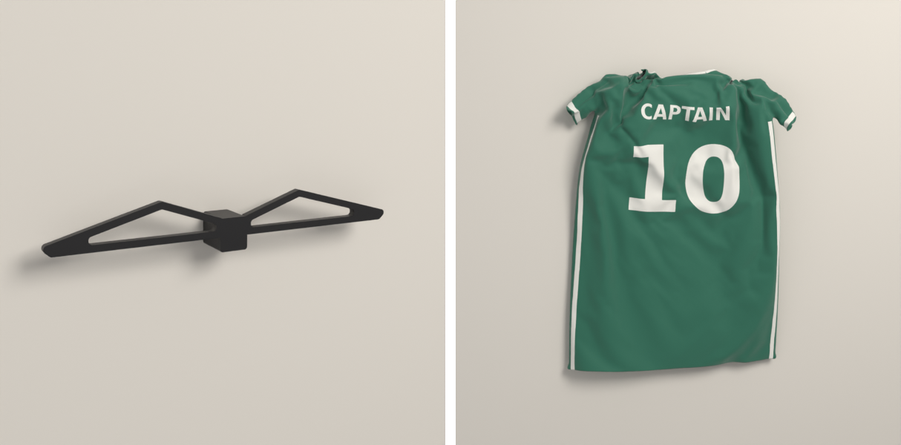
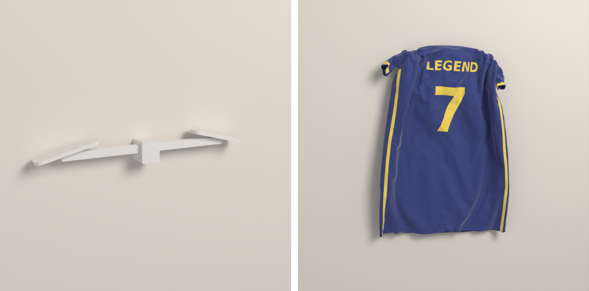
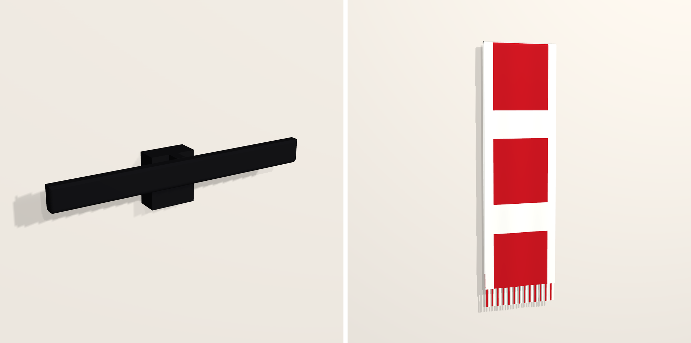
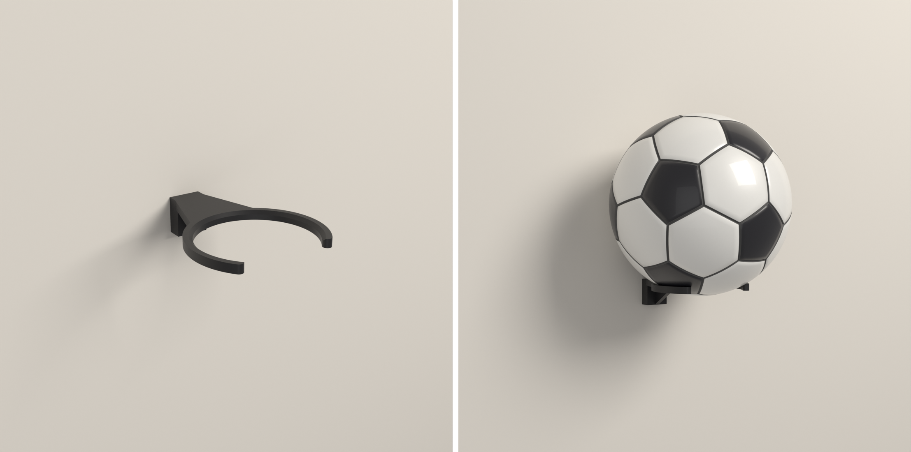
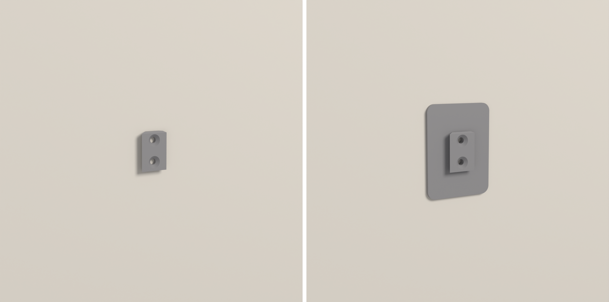

# מתקני תצוגה לקיר – חולצות, צעיפים וכדורים

מודלים פרמטריים להדפסת תלת־ממד (CadQuery). כל המידות במ"מ.


## המוצרים

| מוצר | קבצים (`models/stl`) | רוחב |
|---|---|---|
| מתקן חולצה (שחור, בסיסי) | `jersey_hanger_onepiece` או `hanger_block` + 2× `jersey_hanger_arm` | 372 |
| מתקן חולצה Pro (לבן) – Compact / Regular / Wide | `jersey_hanger_pro_<size>_onepiece` או `hanger_block` + 2× `jersey_hanger_pro_<size>_arm` | 300 / 350 / 400 |
| מסילת צעיף | `scarf_track` | 170 |
| מתקן כדור (מידה 5) | `ball_mount` | 118 |
| תושבת קיר להברגה – משותפת לכולם | `wall_cleat` | 20×29×5 |
| פלטת הדבקה (חולצות וצעיפים) | `adhesive_plate` | 50×69 |
| פלטת הדבקה לכדור | `adhesive_plate_ball` | 60×119 |

קובצי `step/` זהים, לעריכה בתוכנת CAD.

## דוגמאות






## מפרט לספק (RFQ)

`models/rfq/RFQ_spec.pdf` – מסמך באנגלית לשליחה לספק לקבלת הצעת מחיר: דרישות כלליות (חומר, צבע, גימור, טולרנסים), רשימת מוצרים וחלקים, ודף שרטוט לכל חלק. קובצי ה־STEP של החלקים ב־`models/rfq/step/`. נוצר על ידי `python3 models/spec.py`.

## שתי אפשרויות חיבור לקיר



- **קדיחה:** `wall_cleat` עם שני ברגים 4 מ"מ.
- **הדבקה בלבד:** `adhesive_plate` – פלטה שטוחה עם אותה תושבת. מדביקים על כל הגב סרט דו־צדדי חזק (3M VHB 5952 או דומה) או דבק הרכבה. לנקות את הקיר באלכוהול, ללחוץ 30 שניות, ולחכות 24 שעות לפני תלייה. מתאים לקיר חלק וצבוע היטב; לא לטיח מתפורר או טפט. בפלטה יש גם חורי ברגים, אז אפשר לשלב.

## הרכבה

1. מבריגים את `wall_cleat` לקיר עם שני ברגים שקועי־ראש 4 מ"מ (הצד הצר לקיר, הצד הרחב החוצה).
2. מחליקים את המוצר מלמעלה על התושבת – חריץ זנב־יונה מסתיר את הברגים.
3. בגרסה המפוצלת: הזרועות ננעצות בצידי הבלוק בקליק (לשונית מפוצלת עם שיניים, בלי דבק). החיבור קבוע – לא מיועד לפירוק.

**בלוק אחד לכל המשפחה:** `hanger_block` (30×34×34) משמש גם את המתקן השחור וגם את כל מידות ה־Pro; רק הזרועות מתחלפות. כל זרוע סימטרית, כך שימין ושמאל הם אותו חלק. כך אפשר להחזיק מלאי של בלוקים ולהרכיב לפי הזמנה, ולשלוח את המוצר שטוח.

## הדפסה

- **גרסה מפוצלת** מתאימה למשטח 220×220. **גרסת חלק אחד** דורשת משטח גדול (300–400 מ"מ).
- מתקני החולצות: להדפיס כשהפנים הקדמיות על המשטח – בלי תמיכות.
- מסילת צעיף ומתקן כדור: להדפיס הפוך (הצד העליון השטוח על המשטח) – בלי תמיכות.
- תושבת קיר: הצד הרחב על המשטח.
- שכבה 0.2, 4 קירות. מילוי: בלוק 15%, זרועות 25%, מתקן כדור 40%.
- לזרועות עם חיבור הקליק עדיף PETG (גמיש יותר מ־PLA; השיניים מתכופפות כ־0.5 מ"מ בהכנסה). אם הקליק הדוק או רופף מדי – לשנות `JOINT_FIT` / `BARB` ב־`build.py`.

## שינוי מידות

כל המידות הן פרמטרים ב־`models/build.py` (רוחב, מרווחי התאמה `FIT` / `JOINT_FIT`, קוטר כדור וכו').

```bash
pip install cadquery matplotlib
python3 models/build.py     # STL + STEP
python3 models/render.py    # תמונות תצוגה
python3 models/scenes_blender.py   # הדמיות מציאותיות (pip install bpy; סימולציית בד, כ־15 דקות)
```
