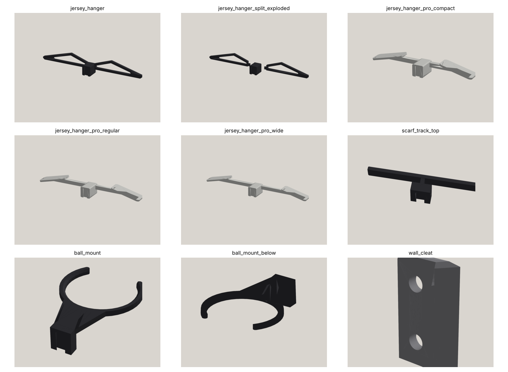

# מתקני תצוגה לקיר – חולצות, צעיפים וכדורים

מודלים פרמטריים להדפסת תלת־ממד (CadQuery). כל המידות במ"מ.



## המוצרים

| מוצר | קבצים (`models/stl`) | רוחב |
|---|---|---|
| מתקן חולצה (שחור, בסיסי) | `jersey_hanger_onepiece` או `jersey_hanger_block` + `arm_left/right` | 372 |
| מתקן חולצה Pro (לבן) – Compact / Regular / Wide | `jersey_hanger_pro_<size>_onepiece` או `jersey_hanger_pro_block` + `<size>_arm_left/right` | 300 / 350 / 400 |
| מסילת צעיף | `scarf_track` | 170 |
| מתקן כדור (מידה 5) | `ball_mount` | 118 |
| תושבת קיר – משותפת לכולם | `wall_cleat` | 20×29×5 |

קובצי `step/` זהים, לעריכה בתוכנת CAD.

## הרכבה

1. מבריגים את `wall_cleat` לקיר עם שני ברגים שקועי־ראש 4 מ"מ (הצד הצר לקיר, הצד הרחב החוצה).
2. מחליקים את המוצר מלמעלה על התושבת – חריץ זנב־יונה מסתיר את הברגים.
3. בגרסה המפוצלת: הזרועות ננעצות בצידי הבלוק (לשונית + טיפת דבק מהיר).

## הדפסה

- **גרסה מפוצלת** מתאימה למשטח 220×220. **גרסת חלק אחד** דורשת משטח גדול (300–400 מ"מ).
- מתקני החולצות: להדפיס כשהפנים הקדמיות על המשטח – בלי תמיכות.
- מסילת צעיף ומתקן כדור: להדפיס הפוך (הצד העליון השטוח על המשטח) – בלי תמיכות.
- תושבת קיר: הצד הרחב על המשטח.
- PETG או PLA, שכבה 0.2, 4 קירות, מילוי 25%+ (מתקן כדור: 40%).

## שינוי מידות

כל המידות הן פרמטרים ב־`models/build.py` (רוחב, מרווחי התאמה `FIT` / `JOINT_FIT`, קוטר כדור וכו').

```bash
pip install cadquery matplotlib
python3 models/build.py     # STL + STEP
python3 models/render.py    # תמונות תצוגה
```
